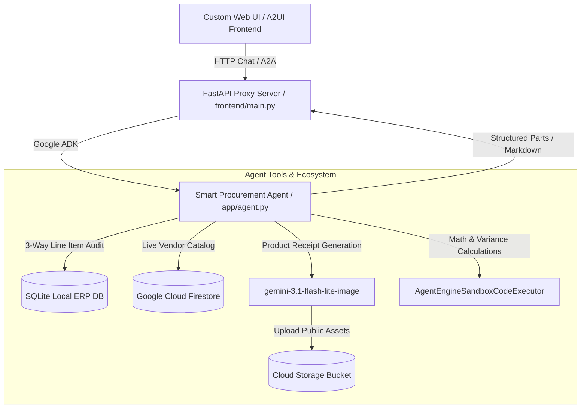

# 📦 Smart Procurement & Vendor Management Agent

An autonomous AI agent designed for **Vendor Management Systems (VMS)** and **Procurement Operations**. Powered by **Gemini 3.8 Flash** and the **Google Agent Development Kit (ADK)**, this system automates vendor invoice auditing, 3-way line item matching, inventory tracking, exception handling, and payment staging.

---

## 🌟 What is the Smart Procurement Agent?

In enterprise procurement, verifying incoming vendor invoices against Purchase Orders and physical warehouse receiving logs is a manual, error-prone, and time-consuming process. 

The **Smart Procurement Agent** serves as an AI-powered Accounts Payable auditor. It continuously inspects incoming invoices, cross-references them with ERP databases and warehouse logs, auto-stages payment drafts for 100% matched records, and flags price/quantity discrepancies for human review.

---

## 🚀 Key Capabilities & Features

### 1. 🔍 Automated 3-Way Line Item Matching
- Cross-checks **Vendor Invoices** (JSON/PDF ingestion) against **ERP Purchase Orders (PO)** and physical warehouse **Goods Receipt Notes (GRN)**.
- Compares line-item unit prices and received quantities line-by-line.

### 2. 🛡️ Discrepancy Detection & Financial Risk Control
- Automatically detects financial risks:
  - **`DISCREPANCY_PRICE`**: Invoice unit price exceeds PO contracted price.
  - **`DISCREPANCY_QTY`**: Invoice billed quantity exceeds actual warehouse received quantity.
  - **`MISSING_PO` / `MISSING_GRN`**: Unlinked invoice or unconfirmed delivery.
- Blocks unverified payments and generates structured manager review tickets (`TICKET-PROC-XXXX`).

### 3. 💳 Automated ERP Payment Draft Staging
- For invoices with **100% Match**, auto-approves payment and stages draft transactions (`ERP-PAY-INV-XXXX-OK`) directly into the ERP accounting queue.

### 4. 🗄️ Live Google Cloud Firestore Catalog Integration
- Interacts with live vendor inventory and catalog items in **Google Cloud Firestore**.
- Performs real-time inventory queries and stock level updates.

### 5. 🎨 Generative Product Visuals & Public Asset Hosting
- Uses **`gemini-3.1-flash-lite-image`** in `global` region to generate high-quality product receipt visuals.
- Uploads images to a public **Google Cloud Storage (GCS)** bucket (`gs://...-procurement-assets`) and embeds clickable public HTTPS URLs in chat responses.

### 6. ⚡ Sandbox Code Execution
- Employs **`AgentEngineSandboxCodeExecutor`** for safe, isolated mathematical variance analysis and data transformation.

### 7. 🖥️ Rich A2UI Surface & Web Frontend
- Renders rich **A2UI v0.8** cards in the ADK Playground.
- Includes a custom **FastAPI Web UI** (`frontend/`) styled with Google Workspace aesthetics, responsive markdown tables, status badges, and quick-action prompt chips.

---

## 🏛️ System Architecture



---

## 📊 Business Logic & Test Scenarios

| Scenario | Invoice ID | Vendor | Billed Amount | Audit Finding | Result | Action Taken |
| :--- | :--- | :--- | :---: | :--- | :---: | :--- |
| **Perfect Match** | `INV-9001` | Acme Office Supplies | $1,500.00 | Unit price & quantity match PO-1001 and GRN-2001 exactly. | **`100% MATCHED`** | Auto-staged ERP payment `ERP-PAY-INV-9001-OK` |
| **Quantity Variance** | `INV-9002` | TechCorp Logistics | $1,500.00 | Billed 5 monitors, but warehouse only received 4. | **`DISCREPANCY_QTY`** | Payment blocked; created ticket `TICKET-PROC-INV-9002` |
| **Price Variance** | `INV-9003` | Global Hardware Ltd | $1,900.00 | Billed $95.00/unit vs PO agreed rate of $80.00/unit. | **`DISCREPANCY_PRICE`** | Payment blocked; created ticket `TICKET-PROC-INV-9003` |

---

## 📁 Repository Structure

```
smart-procurement-agent/
├── app/
│   ├── agent.py               # Main Root Agent definition & tools
│   ├── tools.py               # 3-Way matching & SQLite ERP tools
│   ├── firestore_tools.py     # Live Firestore vendor catalog CRUD tools
│   ├── image_tool.py          # Gemini image generation & GCS upload tool
│   ├── database.py            # SQLite schema initialization
│   ├── sample_data.py         # Sample test invoice datasets
│   └── a2ui_utils.py          # A2UI v0.8 response rewrapping callback
├── frontend/
│   ├── main.py                # FastAPI proxy web server
│   ├── requirements.txt       # Frontend proxy dependencies
│   └── static/
│       └── index.html         # Custom Web Chat UI with Markdown & Badges
├── project_brief.md           # Workshop project specification brief
└── pyproject.toml             # Project dependencies and setup
```

---

## 🚀 Quick Start Guide

### Prerequisites
- Python 3.10+
- `uv` package manager (`pip install uv`)
- Google Cloud Project with Firestore & Cloud Storage enabled

### 1. Run Interactive CLI Agent
```bash
cd smart-procurement-agent
uv run agents-cli run --mode adk "Check pending vendor invoices and run 3-way match on INV-9001"
```

### 2. Launch ADK Web Playground
```bash
uv run adk web . --port 8080 --reload_agents
```
Open **`http://localhost:8080`** in your browser.

### 3. Launch Custom Branded Web App
```bash
cd frontend
uv run python main.py
```
Open **`http://localhost:8085`** in your browser to interact with the custom web app.

---

## 🛠️ Built With

- **[Google Agent Development Kit (ADK)](https://adk.dev)**
- **[Gemini 3.8 Flash](https://deepmind.google/technologies/gemini/)** & **Gemini 3.1 Flash Lite Image**
- **[Google Cloud Firestore](https://cloud.google.com/firestore)**
- **[Google Cloud Storage](https://cloud.google.com/storage)**
- **FastAPI & Uvicorn**
- **A2UI v0.8 Specification**
